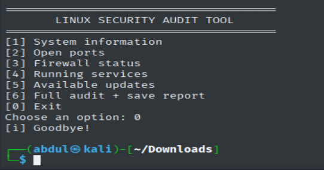

# 🛡️ Linux Security Audit Tool

### Bash-Based Linux Security Auditing & System Monitoring

**Project:** Phase 1 — Bash Automation Tool  
**Internship:** IqraSec Academy — Scripting & Automation  
**Developer:** Abdul Moiz  
**Language:** Bash  
**Platform:** Kali Linux / Ubuntu  
**Status:** Completed

---

## 📌 1. Project Overview

The **Linux Security Audit Tool** is a Bash-based command-line application designed to provide a quick, read-only overview of a Linux system's security configuration and operational status.

The tool features an interactive menu-driven interface that allows users to inspect system information, listening network ports, firewall configurations, running services, and available package updates.

It also provides a full audit option that executes the available checks and automatically saves the results in a timestamped text report.

This project was developed as part of **Phase 1 of the IqraSec Academy Scripting & Automation Internship**.

## 🎯 2. Project Objectives

- Develop an interactive security auditing tool using Bash.
- Automate repetitive Linux system inspection tasks.
- Identify locally listening TCP and UDP ports.
- Inspect firewall status and configuration visibility.
- Review currently running system services.
- Check available package updates.
- Generate timestamped security audit reports.
- Improve Bash scripting, Linux administration, and troubleshooting skills.

## ⚙️ 3. Features

| Feature | Description |
|---|---|
| Interactive CLI | Menu-driven interface with numbered options |
| System Information | Displays hostname, OS, kernel, user, uptime, and IP addresses |
| Network Inspection | Lists listening TCP and UDP ports |
| Firewall Inspection | Checks UFW, firewalld, and available nftables rules |
| Service Monitoring | Displays running systemd services or process information |
| Update Inspection | Checks available APT updates using cached metadata |
| Full Audit | Executes all checks and saves a report |
| Automation Support | Supports direct command-line arguments |
| Read-Only Operation | Does not modify firewall rules, packages, or services |

## 🖥️ 4. Interactive Command-Line Interface

The tool provides an interactive terminal interface that makes security checks accessible without requiring users to remember individual commands.

When executed, the application displays:

```text
========================================
       LINUX SECURITY AUDIT TOOL
========================================

[1] System information
[2] Open ports
[3] Firewall status
[4] Running services
[5] Available updates
[6] Full audit + save report
[0] Exit

Choose an option:
```

### Menu Options Explained

| Option | Operation | Purpose |
|---|---|---|
| 1 | System Information | Retrieve basic Linux system information |
| 2 | Open Ports | Display listening TCP and UDP sockets |
| 3 | Firewall Status | Inspect firewall utilities and available rules |
| 4 | Running Services | Identify active system services |
| 5 | Available Updates | Display available package updates |
| 6 | Full Audit | Execute all checks and save a report |
| 0 | Exit | Terminate the program |

The user enters the corresponding number and presses **Enter** to execute the selected operation.

### 📸 Main Menu Screenshot



*Figure 1: Linux Security Audit Tool interactive interface running on Kali Linux.*

## 🛠️ 5. Technical Requirements

**Supported environments:**
- Kali Linux
- Ubuntu 22.04 or newer
- Other compatible Linux distributions, depending on available utilities

**Required components:**
- Bash 4+
- Standard Linux command-line utilities
- `date`, `hostname`, `uname`, `id`, `sed`, `grep`, `cut`, and `tee`

**Recommended components:**
- `iproute2` for `ss` and `ip`
- `procps` for process inspection

**Optional components:**
- `ufw`
- `firewalld`
- `nftables`
- `systemd`
- `apt`
- `netstat`

Some functionality depends on the Linux distribution and installed utilities.

Administrative privileges may be necessary to inspect certain firewall rules.

## 🚀 6. Installation & Execution

### Step 1 — Open the Terminal

Navigate to the directory containing the Bash script.

```bash
cd Bash-Tool
```

### Step 2 — Make the Script Executable

```bash
chmod +x tool.sh
```

### Step 3 — Launch the Application

```bash
./tool.sh
```

The interactive security auditing menu will appear.

### Step 4 — Select an Operation

For example, enter:

```text
Choose an option: 2
```

The tool will execute the listening-port inspection.

To perform a complete audit:

```text
Choose an option: 6
```

To exit:

```text
Choose an option: 0
[i] Goodbye!
```

## 💻 7. Direct Command-Line Execution

In addition to its interactive interface, the application supports individual checks through command-line arguments.

```bash
# Display system information
./tool.sh --system

# Inspect listening network ports
./tool.sh --ports

# Inspect firewall status
./tool.sh --firewall

# Display running services
./tool.sh --services

# Check available updates
./tool.sh --updates

# Execute complete audit
./tool.sh --all

# Display help information
./tool.sh --help
```

For additional firewall inspection privileges:

```bash
sudo ./tool.sh --all
```

To save reports in a custom directory:

```bash
SEC_AUDIT_REPORT_DIR="$HOME/audit-reports" ./tool.sh --all
```

## 🔍 8. Security Audit Modules

### 8.1 System Information

Retrieves basic information about the local Linux system.

Information includes:
- Hostname
- Operating system
- Kernel version
- Current user
- System uptime
- Global IP addresses

### 8.2 Listening Network Ports

Identifies TCP and UDP sockets listening on the local system.

The tool uses `ss` when available and can fall back to `netstat`.

This information helps administrators identify exposed local services and investigate unexpected listeners.

**Note:** A listening port does not necessarily indicate that the service is accessible from the internet.

### 8.3 Firewall Inspection

Checks the availability and status of supported firewall utilities.

Depending on the environment and privileges, it may inspect:
- UFW
- firewalld
- nftables rules

### 8.4 Running Services

Displays up to 25 running systemd services.

If systemd information is unavailable, the tool can use a process-list fallback.

### 8.5 Available Updates

Checks up to 25 available APT package updates using locally cached package metadata.

The tool does not automatically refresh package metadata or install updates.

### 8.6 Full Security Audit

Combines all available inspection modules into one execution.

The results are displayed in the terminal and saved to a timestamped text file.

## 📄 9. Automated Report Generation

The full audit functionality automatically generates a report inside the `reports/` directory by default.

Example report filename:

```text
audit-YYYYMMDD-HHMMSS-PID.txt
```

The timestamp and process ID help distinguish reports generated during separate executions.

Example report location:

```text
Bash-Tool/reports/audit-YYYYMMDD-HHMMSS-PID.txt
```

Reports can contain system identifiers, network addresses, and service information. Review and redact reports before sharing them publicly.

## 📊 10. Example Output

The following is an illustrative example of the open-port inspection. Actual results vary by system.

```text
------------------------------------------------------------
2. LISTENING NETWORK PORTS (TCP / UDP)
------------------------------------------------------------

Netid State  Recv-Q Send-Q Local Address:Port  Peer Address:Port
tcp   LISTEN 0      128    0.0.0.0:22          0.0.0.0:*

[i] Listening ports are not necessarily
    reachable through the firewall.
```

### Program Exit — Verified Screenshot

```text
Choose an option: 0
[i] Goodbye!
```

The provided screenshot demonstrates that the interactive menu opens and the exit option terminates the application.

## 📸 11. Project Screenshots

The following evidence files document the application's functionality.

| Screenshot | Description |
|---|---|
| `01-main-menu.png` | Interactive CLI and exit operation |
| `02-open-ports.png` | Listening TCP/UDP port inspection |
| `03-firewall-status.png` | Firewall status inspection |
| `04-complete-audit.png` | Full audit and generated report |

Screenshots should be captured from actual executions in the Linux lab environment.

## 🧩 12. Challenges Faced

### Different Linux Utilities

Linux distributions do not always include the same administrative tools.

**Approach:** Check utility availability and provide informative messages or supported fallback commands.

### Firewall Permissions

Detailed firewall inspection may require administrative privileges.

**Approach:** Restrict privileged inspection where appropriate and indicate limited visibility.

### Package Metadata Limitations

Cached APT package information may not reflect the latest available updates.

**Approach:** Clearly describe the limitation rather than presenting cached results as a fresh update check.

### Systemd Compatibility

Not every Linux environment provides accessible systemd service information.

**Approach:** Use a process-list fallback when necessary.

## 🚀 13. Future Improvements

- Add JSON and CSV report export.
- Introduce configurable security audit policies.
- Identify potentially risky listening ports.
- Add severity classifications for audit findings.
- Support additional package managers.
- Introduce automated tests.
- Improve report formatting and summarization.

## 🔐 14. Limitations & Security Considerations

This application provides a basic local security configuration overview.

It is not a complete vulnerability scanner, penetration testing framework, or substitute for professional security assessment.

The tool:
- Does not modify firewall configurations.
- Does not install or remove software.
- Does not terminate services.
- Does not guarantee that a system is secure.
- Should only be executed on owned or authorized systems.

## 👨‍💻 15. Developer Information

**Abdul Moiz**  
Scripting & Automation Intern — IqraSec Academy  
Cybersecurity | SOC Operations | Linux | Bash Automation

**GitHub:** [cyberabdulmoiz](https://github.com/cyberabdulmoiz)

---

**Project:** Linux Security Audit Tool  
**Internship Phase:** Phase 1  
**Language:** Bash  
**Development Status:** Completed

*Developed as an educational scripting and automation project during the IqraSec Academy internship.*
