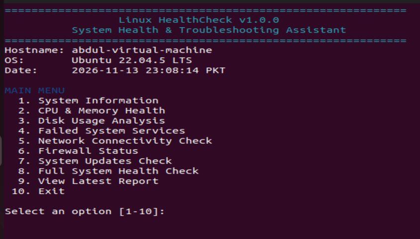
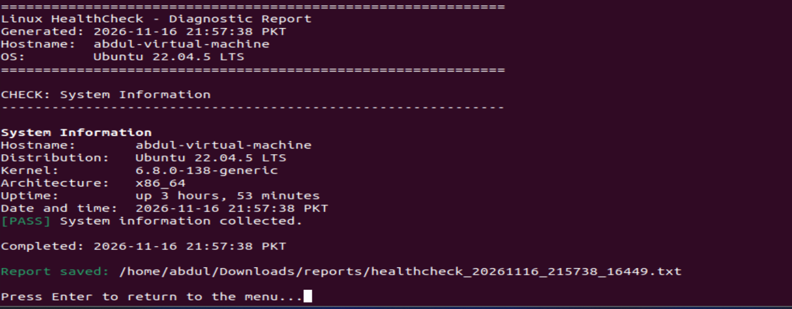
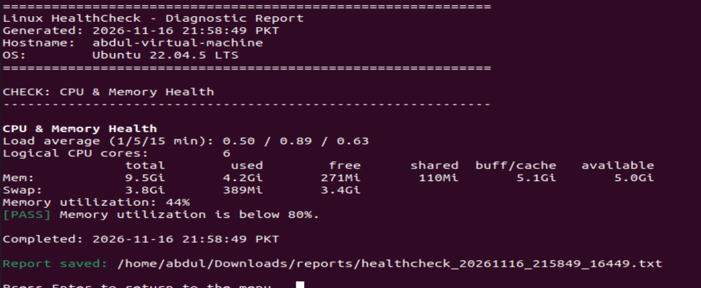
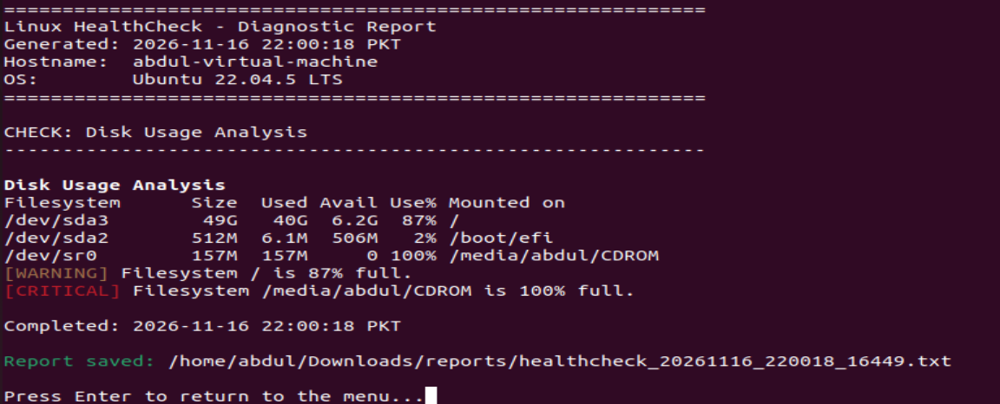
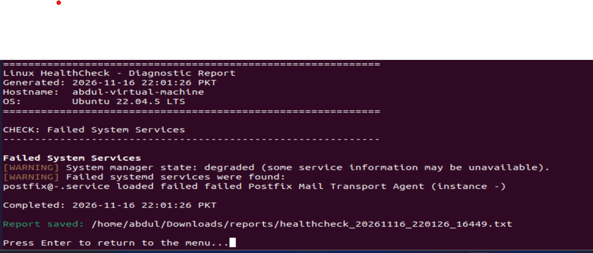
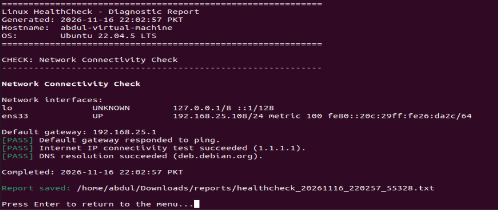
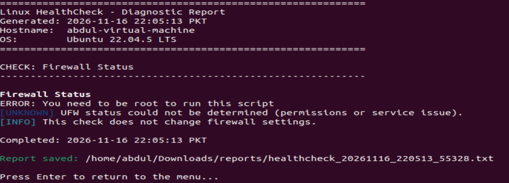
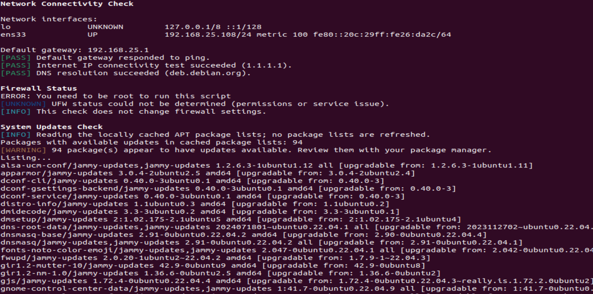
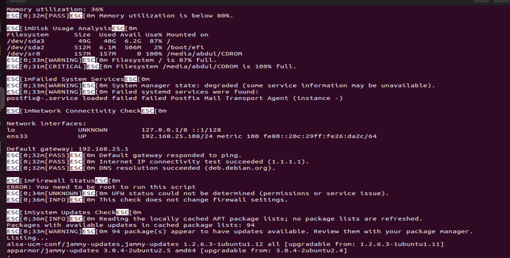

# 🐧 Linux HealthCheck — System Health & Troubleshooting Assistant

**Linux HealthCheck** is a lightweight Bash-based system diagnostic utility designed to help Linux users identify common system health and troubleshooting issues.

It provides an interactive terminal interface that allows users to check system information, CPU and memory usage, disk space, failed services, network connectivity, firewall status, and available package updates.

The tool combines multiple Linux diagnostic commands into one simple utility and generates timestamped diagnostic reports for later review.

---

## 📌 Project Overview

Linux users often need to execute multiple terminal commands to understand system health and troubleshoot common problems.

For beginners, identifying the correct commands and interpreting their output can be challenging.

Linux HealthCheck simplifies this process by providing a centralized diagnostic tool that performs common system checks and presents the results in an organized, understandable format.

It is designed for Linux beginners, IT support technicians, system administrators, and cybersecurity students.

## ✨ Key Features

### 1. System Information
- Display hostname.
- Identify Linux distribution and version.
- Display kernel version.
- Show system architecture.
- Check system uptime.
- Display current date and time.

### 2. CPU & Memory Health
- Display system load averages.
- Identify logical CPU cores.
- Display RAM utilization.
- Show total, used, and available memory.
- Highlight high memory utilization.

### 3. Disk Usage Analysis
- Display mounted filesystem information.
- Show total, used, and available storage.
- Identify filesystems with high disk utilization.
- Warning threshold at 80%.
- Critical threshold at 90%.

### 4. Failed System Services
- Identify failed systemd services.
- Display failed service information.
- Check system manager status.
- Handle systems where systemd is unavailable.

### 5. Network Connectivity Check
- Display network interfaces.
- Identify the default gateway.
- Test gateway connectivity where possible.
- Test internet IP connectivity.
- Check DNS resolution.

### 6. Firewall Status
- Check UFW firewall status.
- Check firewalld status when available.
- Identify whether supported firewall management tools are present.
- Display firewall status information.

The utility does not enable, disable, or modify firewall rules.

### 7. System Updates Check
- Check available package updates through APT.
- Display the number of packages with available updates.
- Show a sample of available package updates.
- Support Ubuntu and Kali/Debian-based systems.

The check uses locally cached package information. It does not automatically refresh repositories or install updates.

### 8. Full System Health Check
Run the available diagnostic modules together:

- System information.
- CPU and memory health.
- Disk usage.
- Failed system services.
- Network connectivity.
- Firewall status.
- Available system updates.

The results use clear status indicators to help users understand diagnostic findings.

### 9. Diagnostic Report Generation
- Generate timestamped text reports.
- Save reports automatically.
- Include hostname and operating system information.
- Record diagnostic results.
- Keep previous reports for later review.
- View the latest generated report directly from the application.

---

## 🌍 Real-World Applications

### 1. Linux Troubleshooting
Help users identify common system problems without manually executing multiple diagnostic commands.

### 2. System Administration
Provide a quick overview of system resources, disk utilization, services, network connectivity, and firewall status.

### 3. IT Support
Assist technicians with preliminary system diagnostics when investigating user-reported Linux problems.

### 4. Cybersecurity Learning
Help students understand Linux system administration and basic security-related checks, including:
- Firewall status.
- Failed services.
- Network connectivity.
- System resource utilization.
- System update availability.

### 5. Linux Beginner Assistance
Provide an accessible way for new Linux users to understand their system's current condition and identify areas that may require attention.

---

## ⚙️ How Linux HealthCheck Works

Linux HealthCheck uses standard Linux utilities to collect system information and perform diagnostic checks.

1. **Launch:** Execute the Bash script.
2. **Select:** Choose a diagnostic option from the interactive menu.
3. **Collect:** The script runs the relevant system commands.
4. **Analyze:** It evaluates available results against basic thresholds and conditions.
5. **Display:** Results appear with PASS, WARNING, CRITICAL, INFO, or UNKNOWN indicators.
6. **Report:** Diagnostic output is saved in a timestamped text report.

---

## 🖥️ Application Screenshots

The following screenshots demonstrate the terminal interface and diagnostic functionality.

### 1. Main Menu


### 2. System Information


### 3. CPU & Memory Health


### 4. Disk Usage Analysis


### 5. Failed System Services


### 6. Network Connectivity


### 7. Firewall Status


### 8. Full System Health Check


### 9. Diagnostic Report


---

## 🚀 Installation & Usage

### Requirements

- Ubuntu or Kali Linux.
- Bash 4.0 or later.
- Standard Linux system utilities.
- A terminal environment.

Some checks depend on utilities such as `ip`, `ping`, `free`, `systemctl`, `ufw`, `firewall-cmd`, and `apt`. Missing utilities are handled where possible.

### Step 1 — Download the Project

Download or clone the repository.

### Step 2 — Open the Project Directory

```bash
cd Bash-Program
```

### Step 3 — Make the Script Executable

```bash
chmod +x linux-healthcheck.sh
```

### Step 4 — Run Linux HealthCheck

```bash
./linux-healthcheck.sh
```

### Step 5 — Select a Diagnostic Option

Choose an option from the interactive menu and follow the terminal instructions.

---

## 📁 Diagnostic Reports

Linux HealthCheck automatically creates a `reports` directory beside the script when a diagnostic is run.

Example:

```text
Bash-Program/
│
├── linux-healthcheck.sh
│
├── reports/
│   ├── healthcheck_20261113_223000_1234.txt
│   └── healthcheck_20261113_224000_1234.txt
│
└── Screenshots/
```

Each report contains:
- Report generation date and time.
- Hostname.
- Operating system.
- Selected diagnostic information.
- Diagnostic output.
- Completion time.

Reports are stored locally and are not automatically uploaded anywhere.

---

## 🛠️ Technologies Used

| Technology | Purpose |
|---|---|
| Bash | Main scripting language |
| Linux CLI Utilities | System diagnostics |
| systemctl | Service status checks |
| ip | Network interface and routing information |
| ping | Connectivity testing |
| getent | DNS resolution testing |
| df | Filesystem usage |
| free | Memory information |
| APT | Package update information |
| awk / sed / grep | Output processing and analysis |

---

## 🔐 Security & Reliability

Linux HealthCheck is designed as a read-only diagnostic utility.

- Does not modify system configuration.
- Does not install or remove packages.
- Does not change firewall settings.
- Does not stop or restart services.
- Does not delete user files.
- Does not modify network configuration.
- Does not require root privileges for ordinary checks.
- Handles unavailable diagnostic commands where possible.
- Provides status indicators for incomplete or unavailable checks.

---

## ⚠️ Limitations

- Primarily designed for Ubuntu and Kali Linux.
- Some checks require specific system utilities.
- Firewall checks recognize UFW and firewalld; other firewall frameworks may not be identified.
- Network tests can be affected by ICMP restrictions or firewall policies.
- APT update information may be outdated because package lists are not refreshed.
- Some system information may be unavailable without appropriate permissions.
- WARNING or CRITICAL results indicate conditions requiring investigation, not necessarily confirmed system failures.
- This tool does not automatically repair detected problems.

Linux HealthCheck is a diagnostic assistant, not an automatic system repair tool or complete security solution.

---

## 📂 Project Structure

```text
Bash-Program/
│
├── linux-healthcheck.sh
│
├── README.md
│
├── reports/
│   └── Generated diagnostic reports
│
└── Screenshots/
    ├── 01-main-menu.png
    ├── 02-system-information.png
    ├── 03-cpu-memory.png
    ├── 04-disk-usage.png
    ├── 05-failed-services.png
    ├── 06-network-check.png
    ├── 07-firewall-status.png
    ├── 08-full-health-check.png
    └── 09-diagnostic-report.png
```

---

## 🎯 Project Objective

Linux HealthCheck was developed as a practical Bash Scripting & Automation project to demonstrate how common Linux diagnostic tasks can be automated through a single interactive terminal utility.

The project focuses on simplifying system troubleshooting, improving Linux administration skills, and making diagnostic information more accessible to everyday Linux users.

**Project:** Linux HealthCheck  
**Category:** Linux Administration / System Diagnostics / Bash Automation  
**Platform:** Ubuntu / Kali Linux  
**Version:** 1.0.0

---

## 📜 License

This project will be distributed under an open-source license. The selected license and its terms will be included in the repository before public release.
