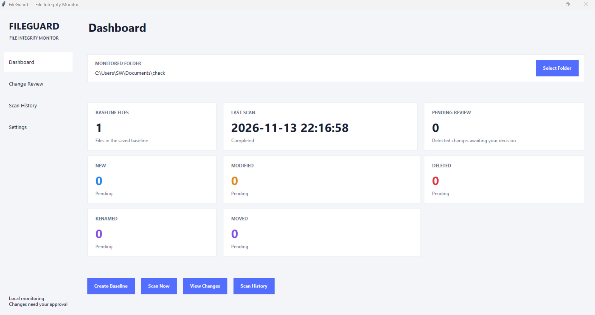
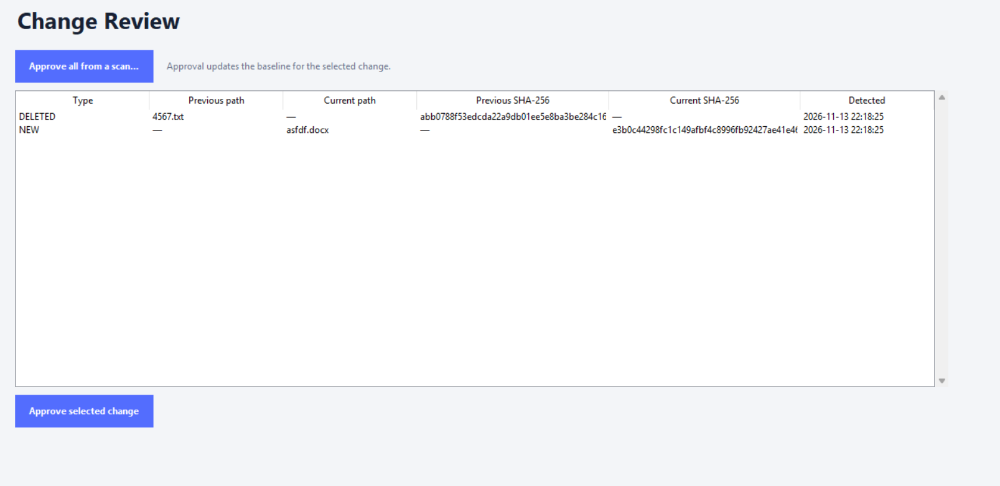
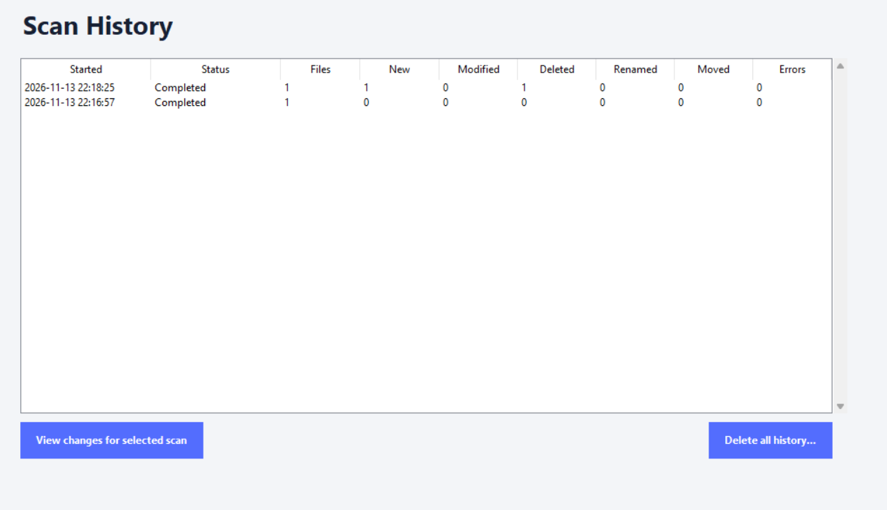
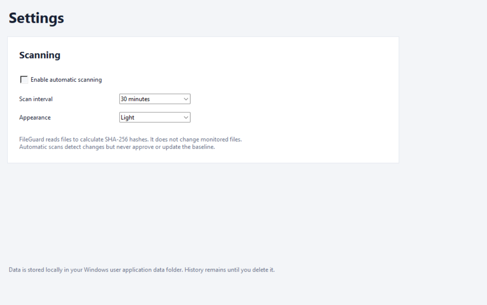
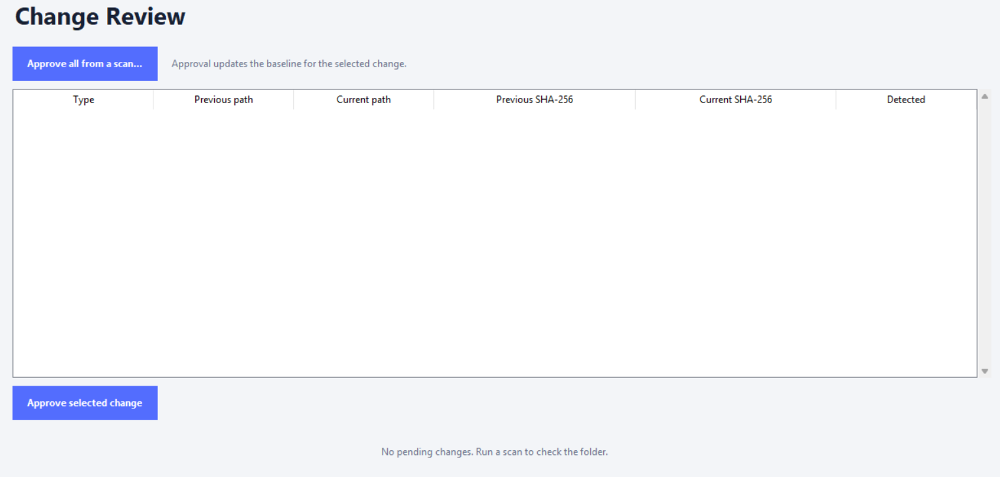

# 🛡️ FileGuard — Windows File Integrity Monitor

**FileGuard** is a lightweight Windows File Integrity Monitoring (FIM) application developed using Python. It helps users monitor important folders, detect unexpected file changes, and review potential security concerns through a simple graphical interface.

FileGuard uses SHA-256 hashing and a locally stored baseline to identify changes in monitored files. It is designed for personal security, cybersecurity learning, and basic file integrity monitoring.

---

## 📌 Project Overview

Files are valuable assets. Unauthorized modifications, accidental deletion, suspicious file replacement, and unexpected changes can create security risks.

FileGuard helps users identify these changes by comparing current file information against a previously recorded baseline.

The application provides a user-friendly dashboard, manual and scheduled scanning, change review, and persistent local records.

## ✨ Key Features

### 🔍 File Integrity Monitoring
- SHA-256 hashing for file integrity verification.
- Monitor one selected folder and its subdirectories.
- Include hidden files.
- Detect changes in file content and paths.
- Maintain a persistent file integrity baseline.

### 🚨 Security Change Detection
- Identify newly created files.
- Detect modifications to existing files.
- Identify deleted files.
- Detect potential file renames and moves.
- Review old and new SHA-256 hashes.
- Highlight unexpected changes for investigation.

### 🛡️ Security Risk Awareness

FileGuard can support basic security investigations by helping users identify:

- Unexpected changes in important documents.
- Files modified without the user's knowledge.
- Newly appearing files in monitored directories.
- Potentially suspicious file replacement.
- Unexpected deletion of important files.
- Changes that may require further investigation.

**FileGuard does not determine whether a file is malicious solely from its hash or modification.** A detected change is an indicator requiring investigation, not proof of malware.

### 📋 Change Review & Baseline Approval
- Review detected file changes.
- Inspect individual change records.
- Approve individual changes.
- Approve changes from a selected scan.
- Update the baseline only through approval.

### ⏱️ Flexible Scanning
- Manual integrity scans.
- Configurable automatic scanning.
- Multiple scan intervals.
- Scan progress display.
- Scan cancellation support.

### 📊 Scan History
- Persistent scan history.
- Review previous scan results.
- Track detected changes.
- Retain records until explicitly deleted.

### 🎨 User-Friendly Interface
- Tkinter graphical interface.
- Dark and light themes.
- Dashboard overview.
- Change Review section.
- Scan History section.
- Settings section.

---

## 🌍 Real-World Applications

### 1. Personal File Security
Monitor important folders containing:
- Personal documents.
- Financial records.
- Photographs.
- School or university assignments.
- Important project files.

Identify unexpected changes during subsequent scans.

### 2. Parental File Monitoring
Parents can monitor a designated folder on a child's computer, with appropriate permission and transparency.

For example, FileGuard can help identify unexpected changes to school documents or files stored in a designated folder.

**FileGuard is not a complete parental-control application.** It does not monitor browsing history, messages, screen activity, or application usage.

### 3. Small Office File Integrity
Small offices can monitor selected folders containing important local documents and review unexpected changes to business files.

### 4. Cybersecurity & SOC Learning
FileGuard demonstrates practical cybersecurity concepts:

- File Integrity Monitoring (FIM).
- SHA-256 hashing.
- Baseline management.
- Change detection.
- Security event review.
- Investigation of unexpected file modifications.

---

## ⚙️ How FileGuard Works

1. **Select a Folder** — Choose a folder to monitor.
2. **Create a Baseline** — Record the initial file information and hashes.
3. **Run a Scan** — Calculate current file hashes.
4. **Compare Files** — Compare current files against the saved baseline.
5. **Detect Changes** — Identify new, modified, deleted, renamed, and moved files.
6. **Review Results** — Inspect detected changes.
7. **Approve Changes** — Update the baseline for changes you trust.

---

## 🗄️ Local Database & Data Storage

FileGuard uses SQLite to store its monitoring records locally.

### Database Location

```text
%LOCALAPPDATA%\FileGuard\fileguard.sqlite3
```

### Stored Information
- File integrity baseline.
- File paths and SHA-256 hashes.
- File sizes and modification times.
- Scan history.
- Detected changes.
- Application settings.
- Change approval records.

The database is created automatically when required.

### Privacy
- No cloud database.
- No remote monitoring server.
- No account registration.
- No automatic cloud uploads.
- Monitored file contents are not uploaded to a remote service.

---

## 🖥️ Screenshots

The following screenshots demonstrate FileGuard's interface and functionality.

### 1. Dashboard


### 2. Change Review


### 3. Scan History


### 4. Settings


### 5. File Integrity Scan Results


---

## 🚀 Installation & Usage

### Option 1 — Windows Executable

1. Download `FileGuard.exe`.
2. Run the executable.
3. Select the folder you want to monitor.
4. Create the initial baseline.
5. Run scans and review detected changes.

### Option 2 — Python Source

Requirements:
- Windows 10 or Windows 11.
- Python.
- Tkinter.

Run:

```bash
python FileGuard.py
```

The application uses Python standard libraries.

---

## 🛠️ Technology Stack

| Technology | Purpose |
|---|---|
| Python | Application development |
| Tkinter | GUI |
| SQLite | Persistent local database |
| hashlib | SHA-256 hashing |
| pathlib / os | File system operations |
| threading | Background scanning |
| queue | GUI and scan communication |

---

## ⚠️ Security Limitations

FileGuard is a file integrity monitoring utility, not a complete endpoint security solution.

- It does not prevent file modifications.
- It does not automatically block malware.
- It does not replace antivirus or EDR.
- It does not provide real-time filesystem protection.
- It does not scan files for malware signatures.
- It does not guarantee that every suspicious activity will be detected.
- It does not replace backups.
- File changes require investigation before being considered malicious.

For stronger protection, use FileGuard alongside Windows Defender, Windows Security, regular backups, and other security controls.

---

## 📂 Project Structure

```text
Python-Program/
│
├── FileGuard.py
├── FileGuard.exe
├── README.md
│
└── Screenshots/
    ├── 01-dashboard.png
    ├── 02-change-review.png
    ├── 03-scan-history.png
    ├── 04-settings.png
    └── 05-scan-results.png
```

---

## 🎯 Project Objective

FileGuard was developed as a practical Python scripting and automation project to demonstrate file integrity monitoring in a Windows desktop environment.

It combines file hashing, baseline comparison, change detection, database persistence, and a graphical review workflow into a simple application.

**Project:** FileGuard  
**Category:** Cybersecurity / File Integrity Monitoring / Python Automation  
**Platform:** Windows 10 / Windows 11

---

## 📜 License

This project will be distributed under an open-source license. License information will be included in the repository before public release.
